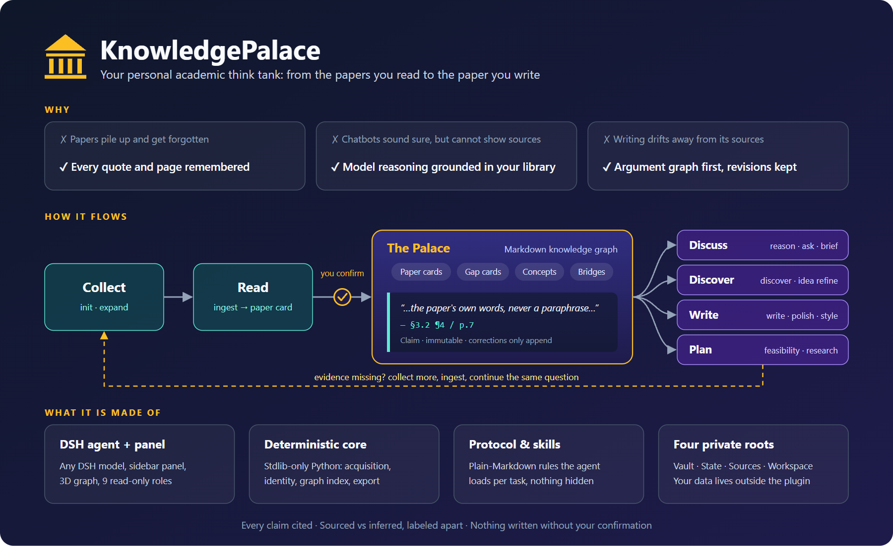
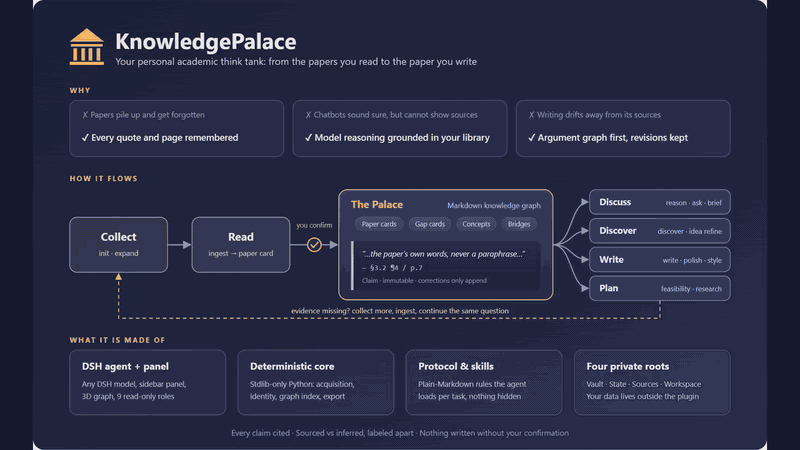

<div align="center">


# KnowledgePalace for DeepSeek Harness

**Your personal academic think tank, inside DeepSeek Harness: it remembers every paper you read — down to the quote and the page — and reasons with it instead of guessing.**

[English](README.md) · [简体中文](README.zh-CN.md) · [Docs](docs/getting-started.md) · [Demo](#demo) · [GitHub](https://github.com/wkqian06/dsh-knowledgepalace)

  

</div>



Papers become *cards*; cards carry *Claims* with a verbatim quote and a page/section anchor; Claims form a hierarchical *graph* the model can reason over; and the graph feeds writing, with an append-only revision history. Everything is plain Markdown in folders you own.

## Install

| Needed | Why |
|---|---|
| DeepSeek Harness with the Web UI | Tested on `0.2.2-rc.5` |
| **Python 3.12 or newer** | The mechanical core is standard-library Python. This is the most common setup problem: if DSH cannot find 3.12+, every library action fails with a message telling you to set `PALACE_PYTHON`. |
| Node.js `^22.19` or `>=24` | Already required by DSH |
| `pypdfium2` *(optional)* | Only to ingest PDF full texts: `pip install pypdfium2` |

**From DSH** — install the bundle in *Plugin Manager* (search `dsh-knowledgepalace` once the plugin market lists it), or ask the agent to *"install the dsh-knowledgepalace bundle"*. A **KnowledgePalace** entry then appears in the sidebar.

**From a checkout** — `git clone https://github.com/wkqian06/dsh-knowledgepalace.git dsh-knowledgepalace`, run `npm install` inside it, then in DSH choose *Plugin Manager → install a local directory* and pick that folder.

## Try the demo library — no setup

The plugin ships a 70-paper demo library in two domains, so there is nothing to configure.

1. Open **KnowledgePalace** in the sidebar and pick **Demo library (drought papers)**.
2. **Explore** → open the global graph, search `flash drought`, click a paper to read its Claims.
3. **Ask** → *"Why did the 2018 European drought persist so long?"*
4. Read the reply: Claims are cited, a bridge from the other domain is raised as a hypothesis, and inference is labelled as inference.

Step-by-step with screenshots: [docs/tutorial-demo-library.md](docs/tutorial-demo-library.md).

## Use your own library

A library is four folders plus a four-line config file. They live outside the plugin folder; a synced or version-controlled location of your own is recommended.

```bash
mkdir -p ~/palace/{vault,state,sources,workspace}
printf '%s\n' 'vault_dir = "vault"' 'state_dir = "state"' \
  'source_dir = "sources"' 'workspace_dir = "workspace"' > ~/palace/.palace.toml
export PALACE_CONFIG=~/palace/.palace.toml   # PowerShell: $env:PALACE_CONFIG = "$HOME\palace\.palace.toml"
```

Restart DSH, choose **Private library**, and ask the agent: `/palace init "your topic" 20`. Windows paths, `PALACE_PYTHON`, and the config rules are in [docs/getting-started.md](docs/getting-started.md) and [docs/configuration.md](docs/configuration.md).

## What it does

| | |
|---|---|
| **Traceable answers** | Every Claim stores its verbatim quote and anchor (`§2.1 [¶1] / p.567`); the agent cites Claim IDs, so any sentence can be checked against the paper. |
| **Honest about what was read** | Each card records `read_depth` and `source_coverage` (full text / excerpt / abstract / metadata). Abstract-only cards never invent full-text findings. |
| **Reasoning, not lookup** | The model explains, compares, hypothesises and proposes what to read next, keeping source-backed statements, background, inference and your own observations apart (below). |
| **Hierarchical graph** | 2D/3D explorer over domains, concepts, papers, gaps and citation edges, with domain-focus hops, year opacity and two-hop neighbourhoods. The index is derived and rebuildable. |
| **Evidence-first writing** | Paragraph analysis → evidence by graph → write from graph → check and save. Revisions are append-only; polishing never overwrites its source. |
| **Collection and maintenance** | Search OpenAlex, Crossref, Semantic Scholar and arXiv with `--live`, ingest selected papers, then audit against sources, review pending judgments, refresh citations, and export a read-only *Viewer* or an Obsidian wiki. |
| **Local-first, bilingual** | Plain files, no server; network only in commands you run with `--live`. UI and docs in English and 简体中文. |

Optional read-only subagents take over one step each: `extractor` (read a paper and draft its card), `stylist` (read a paper's style), `auditor` (audit material against its sources) and `reviewer` (review a draft section). The main agent always owns the writes.

## Ask is reasoning, not lookup

`/palace ask` runs on two layers. **Retrieval** is deterministic: `palace_research ask` returns a bounded reading plan — candidate cards, a few verbatim Claims per work, gaps with their current syntheses, and relations — and the agent reads whatever cards it needs. **Reasoning** belongs to your model, guided by the `palace-discussion` skill: it decides what the question needs, keeps sourced and inferred statements apart, compares definitions and conditions before calling results contradictory, and can continue the same question after collecting more papers.

The reasoning quality is your model's; the "sourced vs. inferred" separation is a contract in the skill plus write-time checks (a saved Claim's quote must be verbatim in the cached source), not a program auditing every answer. Treat a reply as a colleague's draft thinking and open the cited card when it matters. Details: [docs/concepts.md](docs/concepts.md#ask-retrieval-then-reasoning).

## Commands

`/palace <command>` and natural language use the same routes.

| Group | Commands |
|---|---|
| Collect | `init <topic> [n]` · `expand <target>` · `ingest [paths\|dois\|slugs]` |
| Discuss | `ask <question>` · `brief onboard\|map\|progress\|gaps\|ideas\|bridges` · `discover` · `idea refine` |
| Write | `write <project> [section]` · `polish` · `feasibility` · `draft intro <topic>` · `research <project>` |
| Maintain | `status` · `updates` · `audit` · `govern` · `refresh` · `domain add\|list` · `style` · `viewer export` · `wiki export` |

Full reference: [docs/commands.md](docs/commands.md).

## Documentation

| | English | 中文 |
|---|---|---|
| Getting started | [getting-started.md](docs/getting-started.md) | [getting-started.zh-CN.md](docs/getting-started.zh-CN.md) |
| Demo-library tutorial | [tutorial-demo-library.md](docs/tutorial-demo-library.md) | [tutorial-demo-library.zh-CN.md](docs/tutorial-demo-library.zh-CN.md) |
| Configuration | [configuration.md](docs/configuration.md) | [configuration.zh-CN.md](docs/configuration.zh-CN.md) |
| Concepts & architecture | [concepts.md](docs/concepts.md) | [concepts.zh-CN.md](docs/concepts.zh-CN.md) |
| Command reference | [commands.md](docs/commands.md) | [commands.zh-CN.md](docs/commands.zh-CN.md) |
| Troubleshooting | [troubleshooting.md](docs/troubleshooting.md) | [troubleshooting.zh-CN.md](docs/troubleshooting.zh-CN.md) |

Contributor notes: [DESIGN.md](DESIGN.md), [CONTEXT.md](CONTEXT.md), [PALACE.md](PALACE.md), agent contract [AGENTS.md](AGENTS.md).

## Demo



About 30 seconds, recorded in the real DSH interface with the demo library: the two-domain graph, a real question answered by Claude Sonnet 5.5 with its Claim citations, and the writing project's argument graph. The wait while the model works is cut from the recording. 中文版: [demo.zh-CN-preview.gif](docs/media/demo.zh-CN-preview.gif).

## About the demo library

- **Real papers, cards only.** 70 DOI-verified papers — 50 on drought research, 20 on atmospheric circulation — with 604 anchored Claims. No PDFs or full texts ship with it.
- **`missing_sources` is expected.** 19 drought cards were read from full texts that are not included, so `/palace status` lists them. The other cards are abstract- or metadata-level, with short abstract records included.
- **Two domains really meet.** Five circulation papers also carry the drought domain, a few drought Claims are tagged with shared patterns, and 121 citation edges (7 of them across domains) come from cached OpenAlex reference lists.
- **Synthetic writing project.** `demo-library/workspace/projects/demo-paper` exists only to show revision history; treat it as sample text. Check every quote against the original paper before citing.

## Development

```bash
npm install
npm run check                                        # syntax check of the JS entry points
npm test                                             # JS tests
python -m unittest discover -s knowledge_palace/tests -t .   # Python tests
```

`index.js` (Host plugin, tools, web endpoint) · `client.js` (Web panel) · `python.js` (interpreter discovery) · `graph-visualization.html` (3D explorer page) · `knowledge_palace/` (Python core: graph, acquisition, workspace, viewer, skills, subagent definitions) · `demo-library/`.

## Acknowledgements

This plugin is the DeepSeek Harness version of [KnowledgePalace](https://github.com/wkqian06/KnowledgePalace) (the Claude Code / Codex version): the `/palace` protocol, the skills, the Vault layout and the Claim-level evidence model come from that project, and this version focuses on strengthening visualisation and interaction.

The database concepts of the [KnowledgePalace](https://github.com/wkqian06/KnowledgePalace) project are architected on Andrej Karpathy's [LLM Wiki pattern](https://gist.github.com/karpathy/442a6bf555914893e9891c11519de94f).

Graph visualisation was inspired by [1-CellBio/dsh-okf](https://github.com/1-CellBio/dsh-okf).

## License

[MIT](LICENSE) © wkqian06
