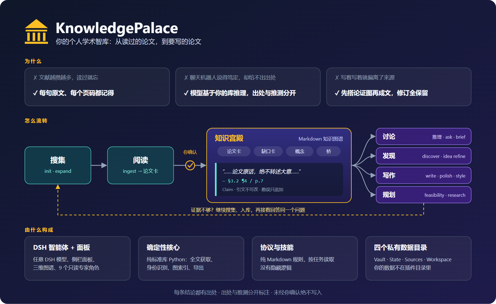
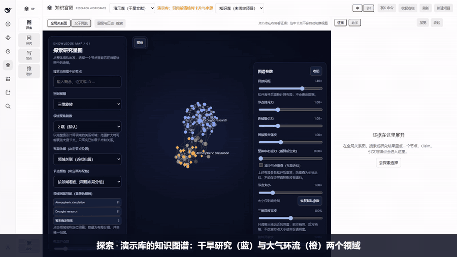

<div align="center">


# KnowledgePalace（知识宫殿）for DeepSeek Harness

**DeepSeek Harness 里的个人学术智库：你读过的每篇论文，连原文引句和页码一起记住，并在此基础上推理，而不是凭空猜测。**

[English](README.md) · [简体中文](README.zh-CN.md) · [文档](docs/getting-started.zh-CN.md) · [演示](#演示) · [GitHub](https://github.com/wkqian06/dsh-knowledgepalace)

  

</div>



论文变成*卡片*；卡片携带 *论点（Claim）*，每条都有原文引句和页码/章节锚点；论点织成分层的*图谱*，模型可以在上面推理；图谱再驱动写作，修订只追加。全部是放在你自己目录里的 Markdown 文件。

## 安装

| 需要 | 用途 |
|---|---|
| 带 Web UI 的 DeepSeek Harness | 测试于 `0.2.2-rc.5` |
| **Python 3.12 或更新** | 机械核心是纯标准库 Python。这是最常见的安装问题：DSH 找不到 3.12+ 时，所有知识库操作都会失败，并提示你设置 `PALACE_PYTHON`。 |
| Node.js `^22.19` 或 `>=24` | DSH 本身已要求 |
| `pypdfium2`（可选） | 仅用于入库 PDF 全文：`pip install pypdfium2` |

**从 DSH 安装**——在 *Plugin Manager* 里安装该插件包（插件市场上架后可直接搜索 `dsh-knowledgepalace`），或直接对智能体说 *“install the dsh-knowledgepalace bundle”*。之后侧边栏会出现 **知识宫殿** 入口。

**从源码安装**——`git clone https://github.com/wkqian06/dsh-knowledgepalace.git dsh-knowledgepalace`，进入目录运行 `npm install`，然后在 DSH 里选择 *Plugin Manager → install a local directory* 并选中该目录。

## 试用演示库——无需配置

插件自带一个两领域、70 篇论文的演示库，开箱即用。

1. 在侧边栏打开 **知识宫殿**，选择 **演示库（干旱文献）**。
2. **探索** → 打开全局关系图，搜索 `flash drought`，点开一篇论文看它的 Claim。
3. **提问** → *“2018 年欧洲干旱为什么持续了那么久？”*
4. 读回答：Claim 被引用，来自另一领域的桥接被作为假设提出，推断被标注为推断。

带截图的分步教程：[docs/tutorial-demo-library.zh-CN.md](docs/tutorial-demo-library.zh-CN.md)。

## 使用你自己的知识库

一个知识库是四个文件夹加一个四行配置文件。它们放在插件目录之外，建议放在你自己会同步或纳入版本管理的位置。

```bash
mkdir -p ~/palace/{vault,state,sources,workspace}
printf '%s\n' 'vault_dir = "vault"' 'state_dir = "state"' \
  'source_dir = "sources"' 'workspace_dir = "workspace"' > ~/palace/.palace.toml
export PALACE_CONFIG=~/palace/.palace.toml   # PowerShell: $env:PALACE_CONFIG = "$HOME\palace\.palace.toml"
```

重启 DSH，选择 **私人知识库**，然后对智能体说：`/palace init "your topic" 20`。Windows 路径、`PALACE_PYTHON` 与配置规则见 [docs/getting-started.zh-CN.md](docs/getting-started.zh-CN.md) 和 [docs/configuration.zh-CN.md](docs/configuration.zh-CN.md)。

## 它能做什么

| | |
|---|---|
| **回答可追溯** | 每条 Claim 都存有原文引句与锚点（`§2.1 [¶1] / p.567`），智能体必须引用 Claim ID，任何一句话都能回到原文核对。 |
| **如实记录读到哪里** | 每张卡片记录 `read_depth` 与 `source_coverage`（全文 / 节选 / 摘要 / 仅元数据）。只有摘要的卡片绝不编造全文结论。 |
| **是推理，不是查表** | 模型解释、比较、提出假设、建议下一步读什么，并把有出处、背景、推断和你自己的观察分开（见下）。 |
| **分层图谱** | 2D/3D 星图浏览领域、概念、论文、研究空白与引用边，支持领域聚焦跳数、年份透明度与两跳邻域。索引是派生的，可随时重建。 |
| **证据先行的写作** | 段落分析 → 按图取证 → 按图写 → 检查并保存。修订只追加，润色绝不覆盖原稿。 |
| **收集与维护** | 用 `--live` 检索 OpenAlex、Crossref、Semantic Scholar 与 arXiv，入库选中的论文；之后可对照来源审计、复核待办判断、刷新引用，并导出只读 *Viewer* 或 Obsidian wiki。 |
| **本地优先、双语** | 纯文件、无服务器；只有你用 `--live` 运行的命令才联网。界面与文档均为中英双语。 |

可选的只读子代理可以接管单个步骤：`extractor`（读一篇论文并起草卡片）、`stylist`（读一篇论文的写作风格）、`auditor`（对照来源审计材料）、`reviewer`（审阅章节草稿）。写入始终由主智能体负责。

## 提问是推理，不是查表

`/palace ask` 分两层。**检索**是确定性的：`palace_research ask` 返回一份有界阅读计划——候选卡片、每篇若干条原文 Claim、研究空白及其当前综合、以及它们之间的关系——智能体按需阅读卡片。**推理**属于你选的模型，由 `palace-discussion` skill 引导：它判断问题需要什么，把有出处和属推断的陈述分开，先比较定义与条件再判定结论是否矛盾，也可以在补充文献后接着回答同一个问题。

推理质量取决于你的模型；“有出处 / 属推断”的区分是 skill 里的约定，加上写入时的检查（保存的 Claim 引文必须与缓存原文逐字一致），并没有程序去审计每一条回答。请把回答当作同事的思考草稿，重要时打开引用的卡片核对。详见 [docs/concepts.zh-CN.md](docs/concepts.zh-CN.md#提问先检索再推理)。

## 命令

`/palace <command>` 与自然语言请求走同一套路由。

| 分组 | 命令 |
|---|---|
| 收集 | `init <topic> [n]` · `expand <target>` · `ingest [paths\|dois\|slugs]` |
| 讨论 | `ask <question>` · `brief onboard\|map\|progress\|gaps\|ideas\|bridges` · `discover` · `idea refine` |
| 写作 | `write <project> [section]` · `polish` · `feasibility` · `draft intro <topic>` · `research <project>` |
| 维护 | `status` · `updates` · `audit` · `govern` · `refresh` · `domain add\|list` · `style` · `viewer export` · `wiki export` |

完整参考：[docs/commands.zh-CN.md](docs/commands.zh-CN.md)。

## 文档

| | English | 中文 |
|---|---|---|
| 快速上手 | [getting-started.md](docs/getting-started.md) | [getting-started.zh-CN.md](docs/getting-started.zh-CN.md) |
| 演示库教程 | [tutorial-demo-library.md](docs/tutorial-demo-library.md) | [tutorial-demo-library.zh-CN.md](docs/tutorial-demo-library.zh-CN.md) |
| 配置 | [configuration.md](docs/configuration.md) | [configuration.zh-CN.md](docs/configuration.zh-CN.md) |
| 概念与架构 | [concepts.md](docs/concepts.md) | [concepts.zh-CN.md](docs/concepts.zh-CN.md) |
| 命令参考 | [commands.md](docs/commands.md) | [commands.zh-CN.md](docs/commands.zh-CN.md) |
| 故障排查 | [troubleshooting.md](docs/troubleshooting.md) | [troubleshooting.zh-CN.md](docs/troubleshooting.zh-CN.md) |

面向贡献者的设计说明：[DESIGN.md](DESIGN.md)、[CONTEXT.md](CONTEXT.md)、[PALACE.md](PALACE.md)，智能体契约 [AGENTS.md](AGENTS.md)。

## 演示



约 30 秒，录自真实的 DSH 界面与演示库：两个领域的知识图谱、由 Claude Sonnet 5.5 真实回答并引用 Claim 的提问，以及写作项目的论证图。模型运行时的等待已从录制中剪掉。English: [demo.en-preview.gif](docs/media/demo.en-preview.gif)。

## 关于演示库

- **真实论文，只带卡片。** 70 篇经 DOI 核验的论文——50 篇干旱研究、20 篇大气环流——共 604 条带锚点的 Claim。不随包提供 PDF 或全文。
- **`missing_sources` 是预期的。** 19 张干旱卡片读自未随包提供的全文，因此 `/palace status` 会列出它们；其余卡片为摘要级或元数据级，附带简短的摘要记录。
- **两个领域真的交汇。** 5 篇环流论文同时带有干旱领域标签，少量干旱 Claim 绑定了共享模式，另有 121 条引用边（其中 7 条跨领域），来自缓存的 OpenAlex 参考文献列表。
- **写作项目是合成的。** `demo-library/workspace/projects/demo-paper` 只用于展示修订历史，请当作示例文本。引用前请对照原论文核实每条引文。

## 开发

```bash
npm install
npm run check                                        # JS 入口语法检查
npm test                                             # JS 测试
python -m unittest discover -s knowledge_palace/tests -t .   # Python 测试
```

`index.js`（Host 插件、工具、web 端点）· `client.js`（Web 面板）· `python.js`（解释器发现）· `graph-visualization.html`（3D 星图页面）· `knowledge_palace/`（Python 核心：图谱、采集、工作区、viewer、skills、子代理定义）· `demo-library/`。

## 致谢

本插件是 [KnowledgePalace](https://github.com/wkqian06/KnowledgePalace)（Claude Code / Codex 版本）的 DeepSeek Harness 版：`/palace` 协议、各 skill、Vault 布局与 Claim 级证据模型均来自该项目，本项目旨在加强可视化与交互操作。

[KnowledgePalace](https://github.com/wkqian06/KnowledgePalace) 项目的数据库概念以 Andrej Karpathy 的 [LLM Wiki 模式](https://gist.github.com/karpathy/442a6bf555914893e9891c11519de94f) 为架构。

图谱可视化方案受 [1-CellBio/dsh-okf](https://github.com/1-CellBio/dsh-okf) 启发。

## 许可证

[MIT](LICENSE) © wkqian06
