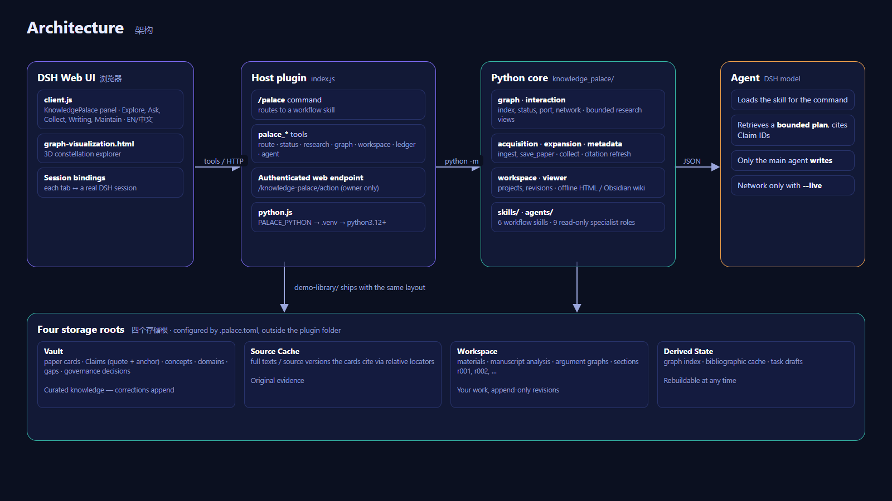

# Concepts & architecture

[English](concepts.md) · [简体中文](concepts.zh-CN.md)



## The four storage roots

| Root | Content | Nature |
|---|---|---|
| **Vault** | paper cards (`papers/`), `concepts.md`, `domains.md`, gap cards, bridge cards (`bridges/`), governance decisions, style records | Curated knowledge — append/correct, never silently rewritten |
| **Source Cache** | full texts and their source versions | Original evidence; cards point to it with a relative `local:` locator |
| **Workspace** | projects: materials, manuscript analysis, argument graphs, sections and revisions | Your work |
| **Derived State** | graph index, bibliographic cache, task drafts | Reconstructible (except `synthesis-updates.json`, which also stores review decisions) |

The **Graph Index** is derived from the Vault. It can always be rebuilt (`palace_rebuild_index`); it is never the source of truth.

## Paper card

A Markdown file with YAML front matter. Real example from the demo library (`demo-library/vault/papers/drought-2010-spei.md`):

```markdown
---
slug: drought-2010-spei
title: "A Multiscalar Drought Index Sensitive to Global Warming: …"
year: 2010
venue: "Journal of Climate"
source: "10.1175/2009jcli2909.1"     # DOI
local: "fulltext/drought-2010-spei.txt"
read_depth: abstract                  # full | skim | abstract | metadata
source_coverage: abstract
domain: [drought-research]
---

## Claims
- C1 [drought-research]: "The authors propose a new climatic drought index: the standardized precipitation evapotranspiration index (SPEI)." — Abstract / Crossref record
```

- **Claim** = a *verbatim quote* + an *anchor* (section, paragraph, page). Claim IDs (`C1`, `C2`, …) are immutable; the cross-library reference form is `claim:<paper-slug>#C1`.
- **`read_depth` / `source_coverage`** state what was actually read. An abstract-only card never contains invented full-text findings; a metadata-only card has no scientific Claims. Having a full text is not the same as having read it.
- Citation counts and venue are stored as dated **bibliographic context**, never as a measure of correctness.

## Corrections instead of edits

| Error kind | Action |
|---|---|
| **Scientific** — quote is accurate, but its reading/scope was wrong | Append a *Correction* (and a new Claim if needed); the quote stays. |
| **Transcription** — recorded wording differs from the source | Repair the quote in place toward the source. It is accepted only if verbatim in the cached text. |
| **Provenance** — quote is not in this work | Retract in place: `- Retraction of C<n> (<date>): <note>`. |

## Graph model

Node kinds: **domain**, **concept**, **work (paper)**, **research gap**, **bridge**. Concepts live on seven axes: `domain`, `task`, `pattern`, `function`, `method`, `metric`, `failure-mode`. Cross-domain connections go through shared axes, gap analogies or directed bridge cards — never as parent/child edges between domains.

Edges include containment (hierarchy), `cites` (the arrow points from the *cited* paper to the paper that cites it — knowledge flow), and evidence relations between Claims and gaps.

The explorer lets you change layout basis, colour basis, domain-focus hops (1–N), paper-year opacity, cluster spacing, repulsion/attraction, 3D depth brightness and node count. Sizes are log-scaled per node type and are not comparable across types.

## Ask: retrieval, then reasoning

Ask is a conversation with the DSH model. The plugin supplies *retrieval* and a *contract*; the model supplies the *reasoning*.

**Retrieval — deterministic.** `palace_research` with `view: "ask"` returns a **bounded reading plan**: candidate cards (with paths and why they matched), a few verbatim Claims per work chosen for the query, gap syntheses, Claim-to-gap relations and pending updates. Each work shows only some of its Claims — the agent opens the card when it needs more. Other views: `progress`, `updates`, `bridges`, `novelty`, `assess`, `partition`, `source`.

**Reasoning — the model, under the `palace-discussion` skill.** The skill tells the agent to:

- choose what the question actually needs: background explanation, paper evidence, cross-paper comparison, a tentative explanation, or a research decision;
- keep four kinds of statement apart: *source-backed*, *background explanation*, *system inference / hypothesis*, *user observation*;
- discuss a hypothesis even when no gap or bridge card exists — coverage records describe only the literature-backed part and never forbid background explanation;
- compare definitions, study conditions, measured outcomes and alternative explanations before calling results contradictory;
- offer a useful next question when the evidence cannot discriminate;
- when evidence is missing and you allow collection, run `init`/`expand` and ingest the adopted papers, then **continue the same question** (unselected search hits are never evidence);
- when a work from another domain shares a pattern, function or failure mode with what was retrieved — and a Claim on each side binds the shared concept — raise the connection as a *hypothesis*, say what would have to hold in your setting, and leave it out when it does not bear on the question;
- on request, save the discussion into the project's research notes (decisions, alternatives, constraints, next action).

An illustrative reply to *"Why did the 2018 European drought persist so long?"* (the cited Claims are real, from the demo library; wording varies with the model):

> **Source-backed** — A high-pressure system sat over central Europe from April to mid-October 2018, producing the long drought spell and record heat `[europe-2020#C3]`; the 500 hPa height anomalies, a marker of circulation persistence, were about two standard deviations above normal `[europe-2020#C9]`.
> **Bridge · atmospheric circulation** — Why such a pattern stalls is the circulation literature's question: Coumou et al. link persistent jet-stream patterns to quasi-stationary Rossby waves `[coumou-2014#C1]` and, from spectral analysis of the wind field, to amplification of waves with zonal wavenumbers 6–8 `[coumou-2014#C2]`. That is a hypothesis for 2018, not something the ecosystem study tested.
> **Inference** — If 2018 behaved like such an event, the persistence of the circulation, not only the heat, is what to examine when explaining the length of the drought. The retrieved papers do not establish that 2018 was such an event.
> **Next step** — Open `kornhuber-2019-wave7` (its abstract says some summer-2018 extremes were connected by a wave-7 pattern). I set the ENSO and forced-vs-internal candidates aside; they bear less on persistence. Want me to save a bridge card for this link?

**What is and isn't guaranteed.** Reasoning quality is your model's. The separation of sourced and inferred statements is a *contract in the skill*, reinforced where the code can check — `save_paper` accepts a Claim only if its quote is verbatim in the cached source — but no program audits each chat answer. Use the cited card to verify anything important.

## Bridge cards (cross-domain)

A bridge card records a hypothesis that something from another domain could serve a problem in yours. File: `vault/bridges/bridge-<slug>.md` (template: [`knowledge_palace/templates/bridge-card.md`](../knowledge_palace/templates/bridge-card.md)).

| Front-matter field | Meaning |
|---|---|
| `relation` | `similar_problem_pattern` · `transferable_method_function` · `shared_failure_mode` · `shared_validation_logic` · `prerequisite_or_enabler` |
| `from` / `to` | the capability or finding on the other side → the local gap or task it could serve |
| `via` | at least two shared-axis concepts, none from the hub-stopword list in [PALACE.md](../PALACE.md) |
| `status` | `candidate` · `monitor` · `pursuing` · `dropped` |
| `gaps`, `papers` | gaps it could address; evidence-carrying papers on both sides |

The body holds the *Hypothesis*, the *Bridge evidence* (one verbatim Claim from each side), *Assumptions & risks*, *First validation step* and an append-only *Decision log*. Analogy-only or spurious connections are reported and dropped — never written as cards.

**Where you meet them.** `ask` returns up to three *bridge candidates* — works from another domain that share a pattern, function or failure mode with the reading set, only when a Claim on each side binds the shared concept — plus saved bridge cards that touch the reading set; the model mentions one only if it bears on your question. `brief bridges <domain-a> <domain-b>` lists bridge cards by status with one-line hypotheses, plus shared-axis concepts. `discover` develops candidates. Nothing is saved without your confirmation. (The demo library has two domains, so `ask` on a drought question returns bridge candidates from atmospheric circulation; it ships no saved bridge cards.)

**Upgrading from "transfer" versions.** Earlier versions called these *Transfer* cards: `transfers/transfer-*.md`, fields `a` / `c` / `bridges`, graph node kind `transfer`, edge kind `bridge`. They are now `bridges/bridge-*.md`, `from` / `to` / `via`, node kind `bridge`, edge kind `via`. A vault created by an earlier version needs a one-time manual migration — move the folder, rename the `transfer-` slug prefix, map `a`→`from`, `c`→`to`, `bridges`→`via`, update references to old slugs (including governance decisions), then rebuild the index. The new core ignores a leftover `transfers/` folder.

## Writing model

1. **Paragraph analysis** — reasoning flow and language style of the section.
2. **Evidence by graph** — build an argument graph (points, paragraphs, relations); attach Claims to each point with `palace_research … project=<slug>`; points without evidence say "pending", never fabricated.
3. **Write from graph.**
4. **Check and save** — saved as an append-only revision (`r001`, `r002`, …); polishing never overwrites its source by default.

Your own manuscripts, data and notes are *project materials*; they support your writing but never become published-paper Claims.

## Roles and skills

Instructions for each workflow are skills under `knowledge_palace/skills/` (`palace-collection`, `palace-ingest`, `palace-discussion`, `palace-writing`, `palace-feasibility`, `palace-maintenance`). Four optional read-only subagent definitions live in `knowledge_palace/agents/`: `extractor` (read one paper and draft its card), `stylist` (read one paper for its style), `auditor` (check material against its sources) and `reviewer` (review a draft section). `palace_agent` assembles the task; run it in a DSH subagent, or do the step in the session under the same definition and say it was a same-session check. Subagents return drafts; **only the main agent writes**.

## Components

| Part | File |
|---|---|
| Host plugin: tools, `/palace`, authenticated web endpoint | [`index.js`](../index.js) |
| Web panel (Explore · Ask · Collect · Writing · Maintain) | [`client.js`](../client.js) |
| 3D constellation page template | [`graph-visualization.html`](../graph-visualization.html) |
| Python discovery and subprocess runner | [`python.js`](../python.js) |
| Session ↔ project bindings | [`session-bindings.js`](../session-bindings.js) |
| Python core | [`knowledge_palace/`](../knowledge_palace) |

Deeper design notes: [DESIGN.md](../DESIGN.md), [CONTEXT.md](../CONTEXT.md), [PALACE.md](../PALACE.md), `knowledge_palace/protocol/`.
