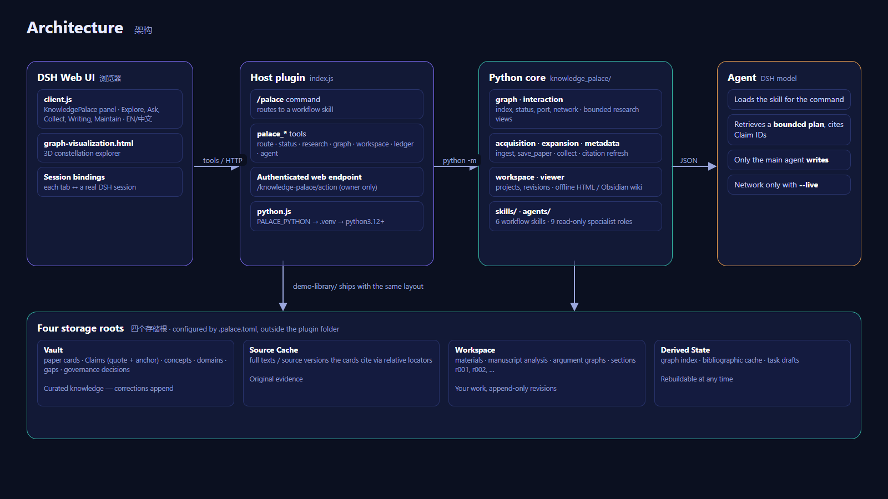

# 概念与架构

[English](concepts.md) · [简体中文](concepts.zh-CN.md)



## 四个存储根目录

| 根目录 | 内容 | 性质 |
|---|---|---|
| **Vault（知识库）** | 论文卡片（`papers/`）、`concepts.md`、`domains.md`、研究空白卡片、桥接卡（`bridges/`）、治理决策、风格记录 | 经过整理的知识——只追加/修正，绝不悄悄改写 |
| **来源缓存（Source Cache）** | 全文及其来源版本 | 原始证据；卡片通过相对路径的 `local:` 定位符指向它 |
| **Workspace** | 项目：材料、稿件分析、论证图、章节与修订 | 你的工作成果 |
| **派生状态（Derived State）** | 图索引、文献元数据缓存、任务草稿 | 可重建（`synthesis-updates.json` 除外，它还保存复核决策） |

**图索引（Graph Index）** 派生自 Vault，随时可以重建（`palace_rebuild_index`）；它从不是事实来源。

## 论文卡片

一个带 YAML front matter 的 Markdown 文件。下面是演示库中的真实示例（`demo-library/vault/papers/drought-2010-spei.md`）：

```markdown
---
slug: drought-2010-spei
title: "A Multiscalar Drought Index Sensitive to Global Warming: …"
year: 2010
venue: "Journal of Climate"
source: "10.1175/2009jcli2909.1"     # DOI
local: "fulltext/drought-2010-spei.txt"
read_depth: abstract                  # full | skim | abstract | metadata
source_coverage: abstract
domain: [drought-research]
---

## Claims
- C1 [drought-research]: "The authors propose a new climatic drought index: the standardized precipitation evapotranspiration index (SPEI)." — Abstract / Crossref record
```

- **论点（Claim）** = 一段*原文引文* + 一个*锚点*（章节、段落、页码）。Claim ID（`C1`、`C2`……）不可变；跨库引用的形式是 `claim:<paper-slug>#C1`。
- **`read_depth` / `source_coverage`** 说明实际读过什么。仅有摘要的卡片绝不会包含编造的全文结论；仅有元数据的卡片没有科学 Claim。拥有全文不等于读过全文。
- 引用数与期刊/会议以带日期的**文献背景信息**形式保存，绝不作为正确性的衡量标准。

## 用修正取代编辑

| 错误类型 | 处理方式 |
|---|---|
| **科学性错误**——引文准确，但对其含义/适用范围的解读有误 | 追加一条 *Correction*（必要时追加新的 Claim）；引文保持不变。 |
| **转录错误**——记录的措辞与来源不符 | 就地依据来源修复引文。只有在缓存文本中逐字存在时才会被接受。 |
| **出处错误**——引文并不在这篇论文中 | 就地撤回：`- Retraction of C<n> (<date>): <note>`。 |

## 图模型

节点类型：**领域**、**概念**、**论文（work）**、**研究空白**、**桥接（bridge）**。概念分布在七个轴上：`domain`、`task`、`pattern`、`function`、`method`、`metric`、`failure-mode`。跨领域连接通过共享轴、研究空白类比或有向桥接卡实现——绝不作为领域之间的父子边。

边包括包含关系（层级）、`cites`（箭头从*被引*论文指向引用它的论文——知识流动方向）以及 Claim 与研究空白之间的证据关系。

浏览器允许你调整布局依据、颜色依据、领域聚焦跳数（1–N）、论文年份透明度、聚类间距、斥力/引力、3D 深度亮度和节点数量。节点大小按节点类型做对数缩放，不同类型之间不可比较。

## 提问：先检索，再推理

Ask 是与 DSH 模型的一场对话。插件提供*检索*与*约定*，*推理*由模型完成。

**检索——确定性。** `palace_research` 的 `view: "ask"` 返回一份**有界阅读计划**：候选卡片（带路径与命中原因）、围绕查询挑选的每篇若干条原文 Claim、研究空白综合、Claim 与空白的关系以及待复核更新。每篇只展示它的一部分 Claim——需要更多时智能体会打开卡片。其他视图：`progress`、`updates`、`bridges`、`novelty`、`assess`、`partition`、`source`。

**推理——模型，遵循 `palace-discussion` skill。** 该 skill 要求智能体：

- 判断问题真正需要什么：背景解释、论文证据、跨文献比较、暂定解释，还是研究决策；
- 分开四类陈述：*有文献支撑*、*背景解释*、*系统推断 / 假设*、*用户观察*；
- 即使没有空白卡或桥接卡也可以讨论假设——覆盖记录只描述有文献支撑的部分，从不禁止背景解释；
- 先比较定义、研究条件、测量结果与替代解释，再说结果是否矛盾；
- 证据无法区分时，给出一个有价值的下一个问题；
- 证据缺失且你允许收集时，运行 `init`/`expand` 并把采用的论文入库，然后**接着回答同一个问题**（未被选中的检索结果从不算证据）；
- 当另一个领域的某项工作与检索到的内容共享模式、功能或失效模式，且两侧各有一条 Claim 绑定该共享概念时，把这种联系作为*假设*提出，说明在你的场景中需要满足什么条件才能成立；与问题无关时就不提；
- 应你的要求，把讨论存入项目研究笔记（决策、备选方案、约束、下一步）。

下面是对 *“Why did the 2018 European drought persist so long?”* 的一份示意回答（所引 Claim 来自演示库，真实存在；措辞随模型而变）：

> **有出处** — 2018 年 4 月至 10 月中旬，一个高压系统持续笼罩中欧，造成了长时间的干旱和创纪录的高温 `[europe-2020#C3]`；500 hPa 位势高度异常（环流持续性的指标）约比常年高出两个标准差 `[europe-2020#C9]`。
> **桥接 · 大气环流** — 这样的型为何会“停滞”，是环流文献的问题：Coumou 等人把持续的急流型与准静止罗斯贝波联系起来 `[coumou-2014#C1]`，并通过对风场的谱分析，把它归因于纬向波数 6–8 的波被放大 `[coumou-2014#C2]`。这对 2018 年来说是一个假设，不是那篇生态系统研究检验过的内容。
> **推断** — 如果 2018 年的表现类似这类事件，那么在解释这场干旱为何持续这么久时，应当考察环流的持续性，而不只是高温。已检索的论文并没有确立 2018 年就是这类事件。
> **下一步** — 打开 `kornhuber-2019-wave7`（其摘要称 2018 年夏季的部分极端事件由一个 7 波型相连）。我把 ENSO 与外强迫/内变率两个候选搁置了，它们与“持续性”的关系较弱。要我为这条联系保存一张桥接卡吗？

**哪些有保证、哪些没有。** 推理质量取决于你的模型。“有出处 / 属推断”的分开，是 skill 里的*约定*，并在代码能检查的地方加固——`save_paper` 只接受引文与缓存原文逐字一致的 Claim——但没有程序会审计每条聊天回答。重要内容请打开引用的卡片核对。

## 桥接卡（跨领域）

桥接卡记录这样一个假设：另一个领域的某样东西，也许能服务你所在领域的某个问题。文件：`vault/bridges/bridge-<slug>.md`（模板：[`knowledge_palace/templates/bridge-card.md`](../knowledge_palace/templates/bridge-card.md)）。

| 前置字段 | 含义 |
|---|---|
| `relation` | `similar_problem_pattern` · `transferable_method_function` · `shared_failure_mode` · `shared_validation_logic` · `prerequisite_or_enabler` |
| `from` / `to` | 另一侧的能力或发现 → 它可能服务的本地空白或任务 |
| `via` | 至少两个共享轴概念，且不得出自 [PALACE.md](../PALACE.md) 的枢纽停用词表 |
| `status` | `candidate` · `monitor` · `pursuing` · `dropped` |
| `gaps`、`papers` | 它可能回应的空白；两侧承载证据的论文 |

正文包括*假设（Hypothesis）*、*桥接证据（Bridge evidence，两侧各一条原文 Claim）*、*假设与风险*、*第一步验证*以及只追加的*决策日志*。仅为类比或虚假的联系会被报告并丢弃——绝不写成卡片。

**你在哪里会遇到它们。** `ask` 最多返回三个*桥接候选*——来自其他领域、与阅读集共享模式、功能或失效模式的论文，且只有两侧各有一条 Claim 绑定该共享概念时才会出现——外加与阅读集相连的已保存桥接卡；只有与你的问题相关时，模型才会提到。`brief bridges <domain-a> <domain-b>` 按状态列出桥接卡及一行假设，并给出共享轴概念。`discover` 负责进一步发展候选。未经你确认不会保存任何内容。（演示库有两个领域，所以对干旱问题执行 `ask` 会返回来自大气环流领域的桥接候选；它没有随附已保存的桥接卡。）

**从“迁移（transfer）”版本升级。** 早期版本把它们叫作 *Transfer* 卡：`transfers/transfer-*.md`，字段 `a` / `c` / `bridges`，图节点类型 `transfer`，边类型 `bridge`。现在是 `bridges/bridge-*.md`，字段 `from` / `to` / `via`，节点类型 `bridge`，边类型 `via`。由早期版本创建的知识库需要一次性手动迁移——移动文件夹、把 slug 前缀 `transfer-` 改为 `bridge-`、字段映射 `a`→`from`、`c`→`to`、`bridges`→`via`、更新对旧 slug 的引用（包括治理决策），然后重建索引。新内核会忽略遗留的 `transfers/` 文件夹。

## 写作模型

1. **段落分析**——该章节的行文逻辑与语言风格。
2. **按图取证**——构建论证图（论点、段落、关系）；用 `palace_research … project=<slug>` 为每个论点挂上 Claim；没有证据的论点标注“待补”，绝不编造。
3. **按图写。**
4. **检查并保存**——保存为只追加的修订（`r001`、`r002`……）；润色默认绝不覆盖其源文本。

你自己的稿件、数据和笔记属于*项目材料*；它们支撑你的写作，但绝不会变成已发表论文的 Claim。

## 角色与 skill

各工作流的指令是 `knowledge_palace/skills/` 下的 skill（`palace-collection`、`palace-ingest`、`palace-discussion`、`palace-writing`、`palace-feasibility`、`palace-maintenance`）。`knowledge_palace/agents/` 下有四份可选的只读子代理定义：`extractor`（读一篇论文并起草卡片）、`stylist`（读一篇论文的写作风格）、`auditor`（对照来源审计材料）、`reviewer`（审阅章节草稿）。由 `palace_agent` 组装任务，交给 DSH 子代理执行；也可以在本会话里按同一份定义完成，并说明这是同会话检查。子代理只返回草稿；**只有主智能体才会写入**。

## 组成部分

| 部分 | 文件 |
|---|---|
| Host 插件：工具、`/palace`、经认证的 web 端点 | [`index.js`](../index.js) |
| Web 面板（探索 · 提问 · 收文献 · 写作 · 维护） | [`client.js`](../client.js) |
| 3D 星座页面模板 | [`graph-visualization.html`](../graph-visualization.html) |
| Python 发现与子进程运行器 | [`python.js`](../python.js) |
| 会话 ↔ 项目绑定 | [`session-bindings.js`](../session-bindings.js) |
| Python 核心 | [`knowledge_palace/`](../knowledge_palace) |

更深入的设计说明：[DESIGN.md](../DESIGN.md)、[CONTEXT.md](../CONTEXT.md)、[PALACE.md](../PALACE.md)、`knowledge_palace/protocol/`。
