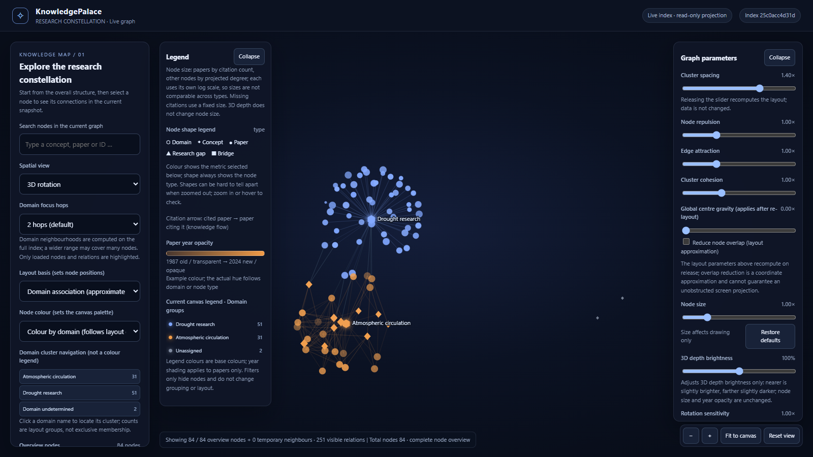
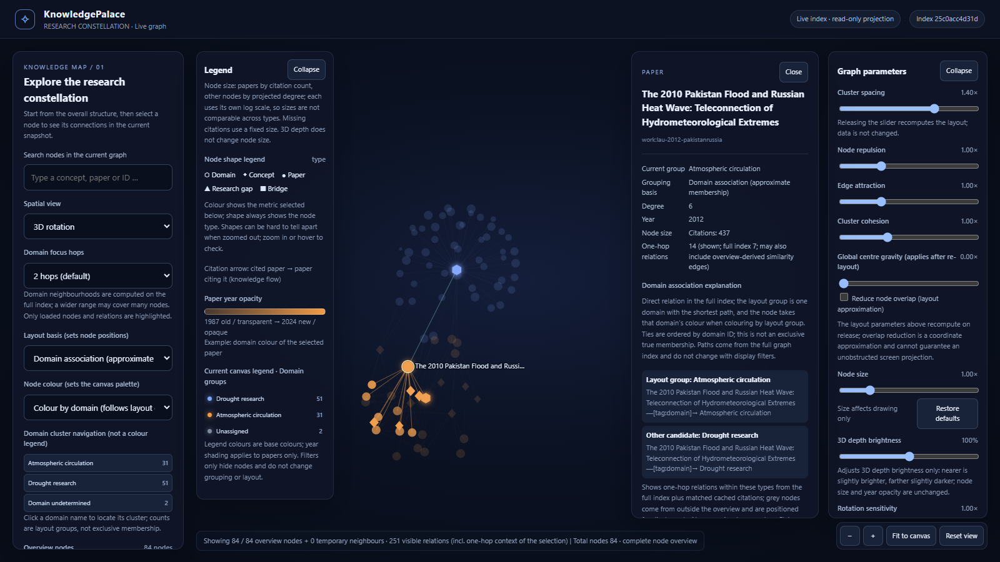

# Tutorial: explore the demo library

[English](tutorial-demo-library.md) · [简体中文](tutorial-demo-library.zh-CN.md)

The plugin ships a ready-made library, **Demo library (drought papers)**: 70 real, DOI-verified papers in two domains — 50 on drought (monitoring, attribution, forecasting, impacts) and 20 on atmospheric circulation (Hadley cell, blocking, planetary waves, teleconnections) — with 604 anchored Claims. Five circulation papers also carry the drought domain, so the two fields meet in the graph. It needs no configuration, so it is the best way to learn the workflow. Every number below was produced by running the plugin against `demo-library/`.

> **Before citing anything from the demo:** the demo ships cards and short abstract records, not the papers themselves. Check each quote against the original paper. See [About the demo library](../README.md#about-the-demo-library).

▶ Prefer video? [demo.en.mp4](media/demo.en.mp4) covers the same path in about 2 minutes, recorded in the real interface.

## 1. Open the demo library

Sidebar → **KnowledgePalace** → *Choose library* → **Demo library (drought papers)**. A banner reminds you to verify cards and sources before citing.

## 2. Check its health — *Maintain*

Run `/palace status` (or *Maintain → Check library status*). For the demo you should see:

```text
papers: 70    claims: 604    domains: 2
index:  fresh (idempotent rebuild verified)
parity: 70 card files = 70 index rows
missing_sources: 19 full-text cards (the demo ships cards, not full texts)
```

`index: fresh` means the derived graph matches the vault. `missing_sources` is expected here: those 19 cards were read from full texts the demo does not include.

## 3. See the whole structure — *Explore*

Open **Global graph**. Each dot is a paper (size ∝ citation count in the library), there are two hubs — `Drought research` (blue) and `Atmospheric circulation` (orange, with its concepts as diamonds) — lines are relations, and arrows on citation edges point from the cited paper to the citing paper.



Things to try (right panel = *Graph parameters*, left panel = *Spatial view* and legend):

- **Spatial view** → *3D rotation*; drag to rotate, scroll to zoom, *Fit to canvas* / *Reset view* to recover.
- **Search nodes** → type `flash drought`; matches are highlighted.
- **Node colour** → *Colour by domain*; **Paper year opacity** fades older papers (1987 → transparent, 2024 → opaque).
- **Domain focus hops** → widen from 1 to 2+ hops to include neighbours of the focused domain.

Click a paper to open its **card** — summary, Claims with quotes and anchors, tags, reading notes.



## 4. Ask — the model reasons with your library

Type a question in *Ask* (or use `/palace ask …`). The demo shows its best side on a question that crosses the two domains:

> Why did the 2018 European drought persist so long?

**Step 1 — retrieval.** The plugin builds a bounded reading plan: 15 candidate cards (led by `europe-2020-drought-ecosystems`) with a few verbatim Claims each — the most relevant:

| Claim | Quote | Anchor |
|---|---|---|
| `claim:europe-2020-drought-ecosystems#C3` | "In April 2018, a high-pressure system established over central Europe and persisted almost continuously until the middle of October, thereby causing a long-lasting drought spell and record temperatures in central and northern Europe." | §1 Introduction / p.2 |

Alongside the plan come **bridge candidates**: works from the *other* domain that share a mechanism with what was retrieved. A row appears only when a Claim on each side binds the same shared concept. This question returned three:

| Shared concept | Atmospheric-circulation Claim | Drought-side Claim it matches |
|---|---|---|
| `persistent-circulation-anomaly` | `coumou-2014-resonantregimes#C1` "Many of these events were associated with anomalous jet stream circulation patterns characterized by persistent high-amplitude quasi-stationary Rossby waves." | `europe-2020-drought-ecosystems#C3` |
| `forced-vs-internal-variability` | `dole-2011-russianheatwave#C1` "Analysis of observations indicate that this heat wave was mainly due to internal atmospheric dynamical processes that produced and maintained a strong and long-lived blocking event…" | `china-2019-flash-drought-risk#C15` |
| `ocean-atmosphere-teleconnection` | `ropelewski-1987-enso-precip#C1` "We investigate the “typical” global and large-scale regional precipitation patterns that are associated with the El Niño/Southern Oscillation (ENSO)." | `drought-2018-carbon-cycle-review#C28` |

**Step 2 — reasoning.** The model decides which of these bear on the question. A reply typically states what the drought papers establish (the high-pressure system that persisted from April to mid-October, `europe-2020#C3`); raises the *relevant* bridge as a hypothesis — the circulation literature links persistent jet-stream patterns to quasi-stationary Rossby waves (`coumou-2014#C1`) — and says what would have to hold for that to explain 2018; labels this as inference; sets the ENSO and forced-vs-internal candidates aside as less pertinent here; and proposes a next step, for example opening `kornhuber-2019-wave7` (its abstract says some of the summer-2018 extremes were connected by a wave-7 circulation pattern) and offering to save a bridge card. The full illustrative reply is in the demo video and in [Ask: retrieval, then reasoning](concepts.md#ask-retrieval-then-reasoning). Nothing is saved without your confirmation.

Try follow-ups — it is multi-turn: *"Was 2018 a resonance-type event?"*, *"What would settle it?"*, *"Save this as a decision in my project notes."* If the library lacks evidence and you allow it, the agent can search, ingest and continue the same question.

The two domains also show up in `/palace brief bridges drought-research atmospheric-circulation`, which lists three corridors — one per shared concept above — each with the papers on both sides. Use *Open in Evidence* to read a Claim in context, or *Locate in graph* to see where a paper sits.

## 5. Read the card behind an answer

Cards are plain Markdown in `demo-library/vault/papers/`. Open `flash-2021-definition-sensitivity.md`: each Claim has an immutable ID, a verbatim quote and an anchor such as `§2.1.1 SMVI [¶1] / p.567`. Note the `read_depth` and `source_coverage` fields — they tell you whether a card was written from the full text or only the abstract.

## 6. Writing with evidence — *Writing*

`demo-library/workspace/projects/demo-paper` is a **synthetic** project that shows the mechanics (it is not research). In *Writing* choose the project and the `introduction` section:

1. **① Paragraph analysis** – reasoning flow and style notes.
2. **② Gather evidence by graph** – each point in the argument graph gets Claims from `palace_research`; points without evidence stay "pending".
3. **③ Write from graph.**
4. **④ Check and save** – saved as an append-only revision. The demo has `r001`, `r002`, `r003`; use *Compare* to see a diff.

## 7. Export a read-only Viewer

```text
/palace viewer export ~/Desktop/drought-viewer.html
```

You get one offline HTML file (no server, no network) that you can email or archive. Add `--lean` when running `python -m knowledge_palace.viewer.cli` by hand for a smaller file.

## Where to go from here

Make your own library with [getting-started](getting-started.md#3-create-your-private-library), then `/palace init "<your topic>" 20`.
