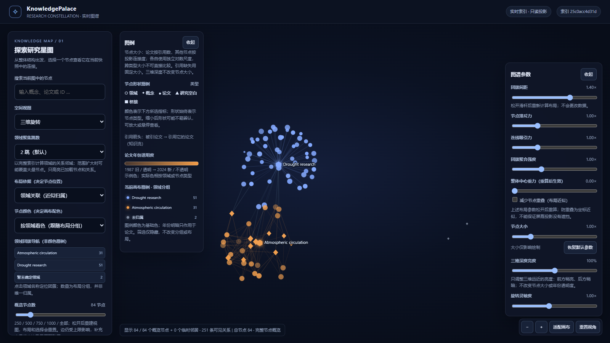
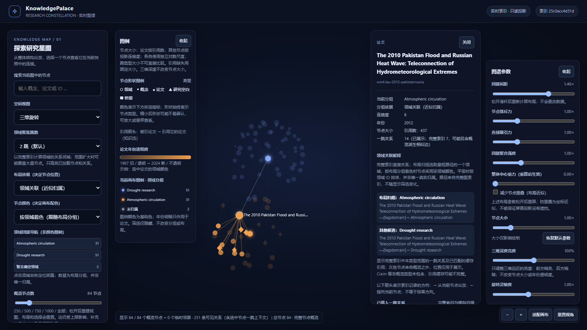

# 教程：探索演示库

[English](tutorial-demo-library.md) · [简体中文](tutorial-demo-library.zh-CN.md)

插件自带一个现成的知识库：**演示库（干旱文献）**——两个领域共 70 篇真实、经 DOI 核验的论文：50 篇干旱（监测、归因、预测、影响）、20 篇大气环流（哈得来环流、阻塞、行星波、遥相关），共 604 条带锚点的论点（Claim）。其中 5 篇环流论文同时带有干旱领域标签，所以两个领域在图谱里是交汇的。它无需任何配置，是学习整个工作流的最佳方式。下文所有数字均来自在 `demo-library/` 上实际运行插件的结果。

> **引用演示库中的任何内容之前：** 演示库只带卡片和简短的摘要记录，不带论文本身。请对照原论文核实每条引文。参见[关于演示库](../README.zh-CN.md#关于演示库)。

▶ 更喜欢看视频？[demo.zh-CN.mp4](media/demo.zh-CN.mp4) 用约 2 分钟演示同一条路径，画面录自真实界面。

## 1. 打开演示库

侧边栏 → **知识宫殿** → *选择知识库* → **演示库（干旱文献）**。页面上的横幅会提醒你在引用前核对卡片与来源。

## 2. 检查健康状况——*维护*

运行 `/palace status`（或 *维护 → 检查库状态*）。对于演示库，你应当看到：

```text
papers: 70    claims: 604    domains: 2
index:  fresh (idempotent rebuild verified)
parity: 70 card files = 70 index rows
missing_sources: 19 full-text cards (the demo ships cards, not full texts)
```

`index: fresh` 表示派生图与 Vault（知识库）一致。这里出现 `missing_sources` 是预期的：那 19 张卡片读自演示库不附带的全文。

## 3. 查看整体结构——*探索*

打开 **全局关系图**。每个圆点是一篇论文（大小与其在库内的被引次数成正比），有两个枢纽——`Drought research`（蓝色）与 `Atmospheric circulation`（橙色，其概念以菱形显示），连线是关系，引用边上的箭头从被引论文指向引用它的论文。



可以试试这些操作（右侧面板 = *图谱参数*，左侧面板 = *空间视图*与图例）：

- **空间视图** → *三维旋转*；拖动旋转、滚轮缩放，用 *适配画布* / *重置视角* 恢复视图。
- **搜索节点** → 输入 `flash drought`；匹配项会高亮显示。
- **节点颜色** → *按领域着色*；**论文年份透明度** 会让较早的论文变淡（1987 → 透明，2024 → 不透明）。
- **领域聚焦跳数** → 从 1 跳放宽到 2 跳及以上，纳入所聚焦领域的邻居。

点击一篇论文即可打开它的**卡片**——摘要、带引文与锚点的 Claim、标签、阅读笔记。



## 4. 提问——模型结合你的知识库推理

在 *提问* 中输入问题（或使用 `/palace ask …`）。演示库在一个横跨两个领域的问题上表现最好：

> Why did the 2018 European drought persist so long?

**第 1 步——检索。** 插件先构建一份有界阅读计划：15 张候选卡片（以 `europe-2020-drought-ecosystems` 居首），每张附带若干条原文 Claim——其中最相关的一条：

| Claim | 引文 | 锚点 |
|---|---|---|
| `claim:europe-2020-drought-ecosystems#C3` | "In April 2018, a high-pressure system established over central Europe and persisted almost continuously until the middle of October, thereby causing a long-lasting drought spell and record temperatures in central and northern Europe." | §1 Introduction / p.2 |

阅读计划旁边还会给出**桥接候选**：来自*另一个领域*、与已检索内容共享某种机制的论文。只有两侧各有一条 Claim 绑定同一个共享概念时才会出现一行。这个问题返回了三条：

| 共享概念 | 大气环流一侧的 Claim | 对应的干旱一侧 Claim |
|---|---|---|
| `persistent-circulation-anomaly` | `coumou-2014-resonantregimes#C1` "Many of these events were associated with anomalous jet stream circulation patterns characterized by persistent high-amplitude quasi-stationary Rossby waves." | `europe-2020-drought-ecosystems#C3` |
| `forced-vs-internal-variability` | `dole-2011-russianheatwave#C1` "Analysis of observations indicate that this heat wave was mainly due to internal atmospheric dynamical processes that produced and maintained a strong and long-lived blocking event…" | `china-2019-flash-drought-risk#C15` |
| `ocean-atmosphere-teleconnection` | `ropelewski-1987-enso-precip#C1` "We investigate the “typical” global and large-scale regional precipitation patterns that are associated with the El Niño/Southern Oscillation (ENSO)." | `drought-2018-carbon-cycle-review#C28` |

**第 2 步——推理。** 由模型判断其中哪些与问题相关。一份回答通常会：陈述干旱论文已经确立的内容（高压系统从 4 月持续到 10 月中旬，`europe-2020#C3`）；把*相关的*桥接作为假设提出——环流文献把持续的急流型与准静止罗斯贝波联系起来（`coumou-2014#C1`）——并说明要解释 2018 年需要满足什么条件；把这一点标为推断；把 ENSO 与外强迫/内变率两个候选作为与本题不太相关而搁置；最后提出下一步，例如打开 `kornhuber-2019-wave7`（其摘要称 2018 年夏季的部分极端事件由一个 7 波环流型相连）并提议保存一张桥接卡。完整的示意回答见演示视频以及 [提问：先检索，再推理](concepts.zh-CN.md#提问先检索再推理)。未经你确认不会保存任何内容。

可以接着追问——它是多轮的：*“2018 年是共振型事件吗？”*、*“什么证据能定论？”*、*“把这个存成我项目笔记里的一条决策。”* 如果库里证据不足且你允许，智能体可以去搜索、入库，再接着回答同一个问题。

两个领域也会出现在 `/palace brief bridges drought-research atmospheric-circulation` 里：它列出三条通路——对应上面三个共享概念——并给出两侧的论文。用 *在证据中打开* 在上下文中阅读某条 Claim，或用 *在图中定位* 查看论文在图谱中的位置。

## 5. 阅读回答背后的卡片

卡片是 `demo-library/vault/papers/` 中的普通 Markdown 文件。打开 `flash-2021-definition-sensitivity.md`：每条 Claim 都有不可变的 ID、原文引文，以及形如 `§2.1.1 SMVI [¶1] / p.567` 的锚点。留意 `read_depth` 与 `source_coverage` 字段——它们说明这张卡片是依据全文还是仅依据摘要写成的。

## 6. 基于证据写作——*写作*

`demo-library/workspace/projects/demo-paper` 是一个**合成**项目，用来演示写作机制（它不是真正的研究）。在 *写作* 中选择该项目和 `introduction` 章节：

1. **① 段落分析**——行文逻辑与语言风格笔记。
2. **② 按图取证**——论证图中的每个论点都从 `palace_research` 获取 Claim；没有证据的论点保持“待补”。
3. **③ 按图写。**
4. **④ 检查并保存**——保存为只追加的修订。演示库中有 `r001`、`r002`、`r003`；使用 *对比* 查看差异。

## 7. 导出只读 Viewer

```text
/palace viewer export ~/Desktop/drought-viewer.html
```

你会得到一个离线 HTML 文件（无需服务器、无需联网），可以通过邮件发送或归档。手动运行 `python -m knowledge_palace.viewer.cli` 时加上 `--lean` 可得到更小的文件。

## 接下来去哪里

按照[快速上手](getting-started.zh-CN.md#3-创建私人知识库)创建你自己的知识库，然后运行 `/palace init "<your topic>" 20`。
